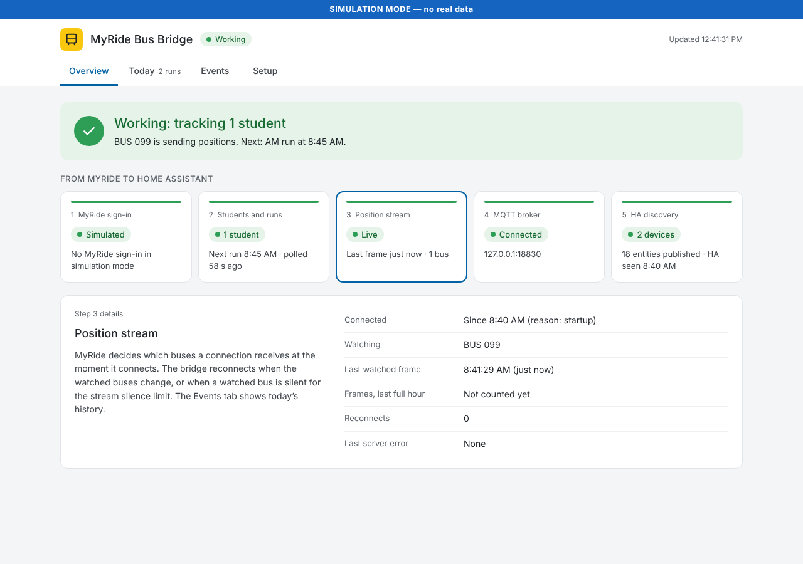

# 🚌 MyRide K-12 for Home Assistant

See where your kid's school bus is, right in Home Assistant. This bridge takes the live
GPS feed behind Tyler Technologies' MyRide K-12 app and turns it into Home Assistant
entities: the bus on your map, how many stops away it is, when it will reach your stop,
and an "approaching" sensor you can use in automations.



## Install

You need:

- **Home Assistant OS** or **Supervised** (on amd64 or aarch64). On Home Assistant
  Container or Core, which can't run apps, see [Other ways to run](#other-ways-to-run).
- A **MyRide K-12 account**, the one you use on
  [myridek12.tylerapp.com](https://myridek12.tylerapp.com).
- Your MyRide **email and password**. The bridge signs in with them itself. (If you'd
  rather not store your password, you can instead copy a sign-in token out of MyRide
  once a month, on a computer with Chrome, Edge or Firefox.)

### Step 1: Install the MQTT broker

Skip this step if you already use the **Mosquitto broker** app.

[](https://my.home-assistant.io/redirect/supervisor_addon/?addon=core_mosquitto)

1. Select the button above, then **Install**, then **Start**.
2. Go to **Settings → Devices & services**. Home Assistant shows the **MQTT**
   integration as discovered. Select **Add** (or **Configure**) and then **Submit**.

The bridge finds the broker by itself, so you never type any MQTT settings.

### Step 2: Install and start the MyRide Bus Bridge app

[](https://my.home-assistant.io/redirect/supervisor_addon/?addon=ae2231fb_myride_bridge&repository_url=https%3A%2F%2Fgithub.com%2Flegrego%2Fmyride-ha-bridge)

1. Select the button above. If Home Assistant asks to add the repository, select
   **Add**.
2. Select **Install**.
3. Turn on **Show in sidebar** and **Watchdog**.

<details>
<summary>Adding the app by hand instead</summary>

1. Go to **Settings → Apps → Install app**.
2. Open the **⋮** menu (top right), then **Repositories**.
3. Paste `https://github.com/legrego/myride-ha-bridge`, then select **Add** and close
   the dialog.
4. Find **MyRide Bus Bridge** in the list (you may need to refresh the page) and select
   it.

</details>

### Step 3: Connect your MyRide account

1. On the app's **Configuration** tab, enter your **MyRide email** and **MyRide
   password** (the ones you use on [myridek12.tylerapp.com](https://myridek12.tylerapp.com)),
   then select **Save**.
2. On the **Info** tab, select **Start** (or **Restart** if it's already running).

The bridge signs in to MyRide by itself, and signs in again whenever its sign-in
expires, so there's nothing more to do.

> Your password is stored on your Home Assistant host with the app's other settings,
> like the MQTT broker's password. If you use the same password elsewhere, consider
> giving MyRide its own, or use a token instead (below).

If MyRide rejects the email and password, the bridge tries them only once (so it
can't lock your account), says so on the **School Bus** page and turns on
`binary_sensor.myride_bridge_credentials`. Correct them on the
**Configuration** tab and restart the app.

<details>
<summary>Use a refresh token instead of your password</summary>

You copy a sign-in token from your browser. It takes about a minute, on a computer
with Chrome, Edge or Firefox (a phone won't work), and you repeat it about once a
month.

1. Start the app with no email and password set. In Home Assistant, open **School
   Bus** in the sidebar and go to the **Setup** tab. It opens **Advanced: use a
   refresh token instead** and shows a snippet under **How do I get a refresh
   token?**. Select **Copy to clipboard**.
2. In a new tab, sign in at [myridek12.tylerapp.com](https://myridek12.tylerapp.com).
3. Press **F12** (on a Mac, **⌥⌘J** in Chrome or Edge, **⌥⌘K** in Firefox) to open the
   developer tools, and select the **Console** tab.
4. Paste the snippet and press **Enter**. If the browser says pasting isn't allowed,
   type `allow pasting`, press **Enter**, and paste again.
5. The snippet prints your **refresh token** (a long string starting with `eyJ`) and
   copies it to your clipboard.
6. Go back to the **School Bus** page, paste the token into the box and select
   **Save token**.

> The refresh token is a sign-in credential for your MyRide account. Don't share it.
> It lasts about 30 days; see [When the token expires](#when-the-token-expires).

</details>

### Step 4: Check that it works

- Open **School Bus** in the sidebar. Within a few seconds its **Overview** tab should
  say **Working**. If something is wrong, it names the broken step (MyRide sign-in,
  students and runs, position stream, MQTT broker or HA discovery) and what to do.
- Go to **Settings → Devices & services → MQTT**. Each student linked to your MyRide
  account is now a device, named after the student.

That's it. The bus only reports its position during runs, so outside school hours
the map pin stays where the bus last parked.

### When the token expires

The bridge's sign-in (its refresh token) lasts about 30 days. With your email and
password set, the bridge simply signs in again, and you don't notice.

With a pasted token and no password, the bridge keeps running when the token
expires, and `binary_sensor.myride_bridge_credentials` turns **on** (you can
[get a notification](#token-expired)). To fix it, copy a new token as in
[step 3](#step-3-connect-your-myride-account). The snippet is on the **School Bus**
page's **Setup** tab, under **Advanced: use a refresh token instead**. The bridge
starts streaming again within seconds, with no restart.

## What you get

Each student is one device. Its entities follow whichever bus the student rides
_today_, including substitute buses, so entity IDs never change when the bus number
does.

For a student with ID `1234567` you get:

| Entity | Type | Description |
|--------|------|-------------|
| `device_tracker.myride_student_1234567` | Device Tracker | Map pin with lat/lng (follows today's bus) |
| `sensor.myride_student_1234567_speed` | Sensor | Speed in mph |
| `sensor.myride_student_1234567_heading` | Sensor | Compass heading (degrees) |
| `binary_sensor.myride_student_1234567_moving` | Binary Sensor | Is the bus in motion? |
| `sensor.myride_student_1234567_bus` | Sensor | Which bus the student is on today |
| `binary_sensor.myride_student_1234567_substitute` | Binary Sensor | Is today's bus a substitute? (ON = yes) |
| `sensor.myride_student_1234567_my_stop` | Sensor | The student's own stop name |
| `sensor.myride_student_1234567_scheduled_time` | Sensor | Scheduled stop time (district-local HH:MM) |
| `sensor.myride_student_1234567_stops_away` | Sensor | Route-derived count of stops still ahead |
| `sensor.myride_student_1234567_distance_to_stop` | Sensor | Distance to the student's stop |
| `sensor.myride_student_1234567_eta` | Sensor | Speed-based ETA to the student's stop |
| `sensor.myride_student_1234567_delay` | Sensor | Minutes behind/ahead of schedule |
| `sensor.myride_student_1234567_predicted_arrival` | Sensor | Schedule-anchored predicted arrival timestamp |
| `binary_sensor.myride_student_1234567_approaching` | Binary Sensor | Is the bus within the approach radius of the stop? |
| `binary_sensor.myride_student_1234567_route_snap_ok` | Binary Sensor | Is stop-progress currently using trusted route mode? |
| `sensor.myride_student_1234567_last_fix` | Sensor | GPS time of the latest fix for the student's bus (diagnostic timestamp) |
| `binary_sensor.myride_student_1234567_feed_live` | Binary Sensor | Has a fix arrived in the last 2 minutes? (diagnostic; OFF = tracking lost) |
| `binary_sensor.myride_bridge_credentials` | Binary Sensor | Credential problem alert (ON = expired or rejected) |
| `binary_sensor.myride_bridge_position_stream` | Binary Sensor | Is MyRide streaming positions for today's bus(es) to the bridge? (diagnostic; OFF = stream silent on a run day, unknown = no runs today; attributes carry connection/reconnect details) |
| `sensor.myride_bridge_last_frame_received` | Sensor | When the bridge last received any position frame, any bus (diagnostic timestamp, updated at most once a minute) |

> Raw per-bus entities (`device_tracker.myride_bus_*`) are no longer published. On
> upgrade the bridge clears the old retained discovery configs so those entities
> disappear from Home Assistant automatically.

### App options

None are needed for a normal setup.

| Option | Description |
|--------|-------------|
| MyRide email, MyRide password | Your MyRide login. The bridge signs in with it, and again whenever its sign-in expires |
| Tenant ID | Your district's MyRide ID. Read from your sign-in; set it only if the log says it couldn't find one |
| Refresh token | Another way to give the bridge a token, not needed with the email and password. Once you submit a token on the status page, that one is used instead |
| District time zone | Used to tell the AM run from the PM run. Leave empty to use your Home Assistant time zone |
| Approach radius | Distance in meters at which "Approaching Stop" turns on (default 500) |
| Bus filter | Track only this bus, such as `BUS 042`. Leave empty to follow each student's bus automatically |
| Log level | `debug`, `info`, `warn` or `error` |

## Automation ideas

To use one, go to **Settings → Automations & scenes → Create automation → Create new
automation**, open the **⋮** menu, select **Edit in YAML**, and paste it. Replace
`1234567` with your student's ID and `notify.mobile_app_your_phone` with your phone's
notify action.

### Bus is almost at your stop

```yaml
alias: School bus approaching
triggers:
  - trigger: state
    entity_id: binary_sensor.myride_student_1234567_approaching
    to: "on"
actions:
  - action: notify.mobile_app_your_phone
    data:
      title: "🚌 Bus approaching!"
      message: >
        The bus is {{ states('sensor.myride_student_1234567_stops_away') }} stops away.
      data:
        ttl: 0
        priority: high
```

### Bus has left school

```yaml
alias: Bus left school
triggers:
  - trigger: state
    entity_id: binary_sensor.myride_student_1234567_moving
    from: "off"
    to: "on"
conditions:
  - condition: time
    after: "14:00:00"
    before: "16:30:00"
    weekday: [mon, tue, wed, thu, fri]
actions:
  - action: notify.mobile_app_your_phone
    data:
      title: "🏫 Bus is rolling!"
      message: "The school bus just started moving. Time to head to the stop!"
```

### Token expired

```yaml
alias: MyRide sign-in stopped working
triggers:
  - trigger: state
    entity_id: binary_sensor.myride_bridge_credentials
    to: "on"
actions:
  - action: notify.mobile_app_your_phone
    data:
      title: "MyRide Bridge: sign-in stopped working"
      message: >
        Check the MyRide email and password on the app's Configuration tab, or
        paste a new refresh token on the School Bus page.
```

### Live bus map card

```yaml
type: map
entities:
  - entity: device_tracker.myride_student_1234567
    name: School Bus
  - entity: zone.home
default_zoom: 14
hours_to_show: 0
```

## Troubleshooting

Start with the **School Bus** page. Its **Overview** tab names the broken step, and
its **Events** tab shows today's sign-ins, reconnects and feed gaps on a timeline.
For the full detail, see the app's **Log** tab, where every line has a timestamp.

### The app won't start
Check that the Mosquitto broker app is installed and running.

### "Couldn't find your district's tenant ID"
The bridge normally reads your district's ID from your MyRide token. If it can't, set
**Tenant ID** on the app's **Configuration** tab. To find it, sign in to MyRide with
the developer tools open on the **Network** tab: requests to
`myridek12.tylerapi.com` carry it in an `x-tenant-id` header.

### Sign-in shows "Rejected"
MyRide refused the email and password. Check them by signing in at
[myridek12.tylerapp.com](https://myridek12.tylerapp.com), correct them on the
**Configuration** tab, and restart the app. The exact reason is in the **Log** tab.
If MyRide asks your account for an extra step, such as a code or a new password, the
bridge can't answer it: use a [refresh token](#step-3-connect-your-myride-account)
instead.

### Sign-in shows "Expired" or "Not set up"
The refresh token has expired, or no email and password or token was set. Follow
[step 3](#step-3-connect-your-myride-account).

### No devices in Home Assistant
Make sure the **MQTT** integration is set up (step 1). The devices are listed under
**Settings → Devices & services → MQTT**.

### The snippet finds no refresh token
Make sure you're fully signed in to MyRide before you run it. If it still finds
nothing:

1. In the developer tools, open the **Network** tab and turn on **Preserve log**.
2. Sign out of MyRide, then sign back in.
3. Type `token` in the Network filter box.
4. Look through the responses for one containing `refresh_token`, and copy its value.

### No location updates
The bus only reports its position during its runs on school days. To check whether any
bus in your district is reporting, clear **Bus filter** if you set one.

MyRide decides which buses a connection receives **when the connection is made**,
from that day's runs; a connection made on a no-run day (weekend, holiday) receives
nothing, even after runs return. The bridge handles this itself: it reconnects as
soon as a roster poll shows a bus it isn't yet watching (`[Stream] reconnect
reason=runs-changed`), and on a run day it reconnects whenever today's bus has sent
no frame for `STREAM_SILENCE_SECONDS` (default 300), backing off to one attempt per
15 minutes while the stream stays silent (`reason=watchdog`). A tracked connection
receives a repeat of the latest fix about every 5 seconds even while the bus is
parked, so silence really means "not tracked". `binary_sensor.myride_bridge_position_stream`
shows the result in Home Assistant, the **Events** tab of the status page draws it on
a timeline, and `GET /status` includes a `stream` section.

### Tracking the wrong bus (e.g. regular bus instead of today's substitute)
On days with both a morning and afternoon run, the bridge picks the run whose
stop-time window matches the current time of day. Those stop times are in the
**district's local time**, so a wrong time zone can push "now" outside the right
window and select the wrong run. Set **District time zone** (or `TZ` outside the app)
to your district's time zone and restart. The `sensor.myride_student_<id>_bus`
entity's `todays_runs` attribute lists every run and which one is currently active
(`current`), with each run's `window_start`/`window_end` and the student's own
`my_stop_time`/`my_stop_action`.

### "Connection closed with an error" + reconnect
Normal. The MyRide server has an idle timeout, and the bridge reconnects with
exponential backoff (1s, 2s, 4s... up to 60s).

### Moving from Docker or Portainer to the app
Stop the old container first, or two bridges publish to the same topics. Entity IDs
stay the same.

## Other ways to run

The app is the easiest way to run the bridge. If your Home Assistant can't run apps
(Container or Core installs), run the bridge yourself and point it at any MQTT broker
that Home Assistant uses.

### Docker Compose

1. Download [`docker-compose.yml`](./docker-compose.yml) and
   [`.env.example`](./.env.example) into a folder, and rename `.env.example` to `.env`.
2. In `.env`, set your broker's `MQTT_BROKER`, `MQTT_USERNAME` and `MQTT_PASSWORD`,
   and your MyRide login in `MYRIDE_EMAIL` and `MYRIDE_PASSWORD`.
3. Run `docker compose up -d`.
4. Open the status page at `http://YOUR_HOST:8099` to check that it works.

> Outside Home Assistant the status page has no login, and it shows your students'
> first names, their runs and stop times, and accepts a refresh token. Keep port
> 8099 on your home network; don't forward it to the internet.

To use a refresh token instead of your password, leave `MYRIDE_EMAIL` and
`MYRIDE_PASSWORD` unset and submit the token on the status page as in
[step 3](#step-3-connect-your-myride-account). The `/data` volume keeps the token
you submitted across container recreates. You can also submit a new token with
`curl -X POST http://YOUR_HOST:8099/token -d 'NEW_REFRESH_TOKEN'`.

### Node.js

Needs Node.js 22 or later.

```bash
git clone https://github.com/legrego/myride-ha-bridge.git
cd myride-ha-bridge
npm install
cp .env.example .env
npm start
```

In `.env`, set your MQTT broker and MyRide login as for Docker Compose, and change
`TOKEN_FILE` to `./data/refresh_token`: the default `/data` is the Docker volume,
which a normal user usually can't write to, and a token you submit on the status page
is saved there. The status page is at `http://localhost:8099`.

<details>
<summary>Run it as a systemd service</summary>

Create `/etc/systemd/system/myride-bridge.service`:

```ini
[Unit]
Description=MyRide K-12 MQTT Bridge
After=network-online.target
Wants=network-online.target

[Service]
Type=simple
User=homeassistant
WorkingDirectory=/opt/myride-ha-bridge
ExecStart=/usr/bin/node src/index.js
Restart=always
RestartSec=30
EnvironmentFile=/opt/myride-ha-bridge/.env

[Install]
WantedBy=multi-user.target
```

With `TOKEN_FILE=./data/refresh_token`, the token is saved in
`/opt/myride-ha-bridge/data`, so give the service user that folder:

```bash
sudo install -d -o homeassistant /opt/myride-ha-bridge/data
sudo systemctl enable --now myride-bridge
sudo journalctl -u myride-bridge -f
```

</details>

### Settings

Outside the app, the bridge is configured with environment variables (or `.env`):

| Variable | Description |
|----------|-------------|
| `MYRIDE_EMAIL`, `MYRIDE_PASSWORD` | Your MyRide login. The bridge signs in with it when it has no working refresh token |
| `MYRIDE_REFRESH_TOKEN` | Refresh token, instead of the email and password (or submit it on the status page) |
| `MYRIDE_TENANT_ID` | District ID. Optional: read from the token when unset |
| `MQTT_BROKER`, `MQTT_PORT`, `MQTT_USERNAME`, `MQTT_PASSWORD` | Your MQTT broker |
| `TZ` | District time zone (default `America/New_York`) |
| `BUS_FILTER` | Track only this bus, such as `BUS 042` |
| `APPROACH_RADIUS_METERS` | Distance for "Approaching Stop" (default `500`) |
| `STREAM_SILENCE_SECONDS` | Silence on a run day before the position stream is reconnected (default `300`) |
| `API_PORT` | Status page port (default `8099`) |
| `TOKEN_FILE` | Where a submitted token is saved (default `/data/refresh_token`) |

If you can't get a refresh token at all, you can set `MYRIDE_ACCESS_TOKEN` to the
`access_token=` value from any SignalR WebSocket URL in the browser's Network tab. It
expires after 60 minutes, so it's only good for a quick test.

The status page also serves `GET /status` (JSON health check), `GET /version` (build
metadata) and `GET /snippet` (the token snippet as plain text).

## How it works

```
  MyRide email + password       or a refresh token copied
  (app options or .env)         from the MyRide web app
         │                               │
         ├───────────────────────────────┘
         ▼
┌─────────────────┐   USER_PASSWORD_AUTH   ┌───────────────────────┐
│  cognito-auth   │   REFRESH_TOKEN_AUTH   │  AWS Cognito          │
│                 │──────────────────────▶ │  us-east-1_sfRczsC0e  │
│                 │◀──── access_token ──── │                       │
└────────┬────────┘   (auto every 50 min)  └───────────────────────┘
         │
         │ access_token
         ▼
┌─────────────────┐    SignalR/WebSocket    ┌───────────────────────┐
│  signalr-client │◀════════════════════▶   │  LiveVehicleHub       │
│                 │   NewLocation events    │  myridek12.tylerapi   │
└────────┬────────┘    (every ~15-30s)      └───────────────────────┘
         │
         │ location data
         ▼
┌─────────────────┐      MQTT + Discovery   ┌───────────────────────┐
│  mqtt-bridge    │─────────-─────────────▶ │  Home Assistant       │
│                 │                         │  Mosquitto app        │
└─────────────────┘                         └───────────────────────┘

┌─────────────────┐
│  api-server     │  ← POST /token  — submit new refresh token
│  (port 8099)    │  ← GET  /status — JSON health check
│                 │  ← GET  /       — browser status UI
└─────────────────┘
```

### Signing in

MyRide's login runs on AWS Cognito. Its public web-app client accepts
`USER_PASSWORD_AUTH`, so the bridge signs in with the email and password directly
(no browser) and gets a Cognito **refresh token**. It then uses Cognito's
`REFRESH_TOKEN_AUTH` flow to get fresh access tokens, and signs in again when the
refresh token expires. The other sign-in flows (SRP, custom and passwordless) are
off. Tyler could turn `USER_PASSWORD_AUTH` off too, so a refresh token captured from
the web app still works as a fallback. See
[the research notes](docs/research/2026-10-28-credential-bootstrap.md).

### Token lifecycle

| Token | Lifetime | Auto-renewed? |
|-------|----------|---------------|
| Access token | 60 minutes | Yes, via refresh token |
| Refresh token | ~30 days (Cognito default) | Yes with an email and password, by signing in again; otherwise re-capture from browser |

The bridge refreshes the access token every 50 minutes automatically. When the
refresh token itself expires, it signs in again if an email and password are set.
If there's no password, or MyRide rejects it (tried once, so the account can't get
locked), the bridge **does not crash**. Instead it:

1. Logs a prominent error banner
2. Stops the SignalR data stream
3. Sets `binary_sensor.myride_bridge_credentials` to **ON** (problem) in Home Assistant
4. Keeps MQTT and the status page running so you can recover without restarting

With no token configured at all, the bridge likewise starts only the status page and
waits for a token.

## Development

### Simulation mode

Run the full bridge without a MyRide account or MQTT broker:

```bash
npm run simulate
```

Four fake buses (BUS 001, BUS 002, BUS 042, BUS 099) do a random walk around a
suburb, sending a location every 5 seconds. The status page runs normally at
`http://localhost:8099` with a blue **SIMULATION MODE** banner; a submitted token is
accepted but ignored. If `MQTT_BROKER` is set, the fake locations are published to
MQTT so you can test Home Assistant automations.

### Tests

```bash
npm test
```

### Releasing the app

The app image is built by `.github/workflows/addon-image.yaml` with Home Assistant's
builder actions. It publishes only when `version` in `myride_bridge/config.yaml` (kept
equal to `package.json`) is new; an existing version is never overwritten. The first
release creates three GHCR packages, `myride-ha-bridge-addon` plus `amd64-` and
`aarch64-myride-ha-bridge-addon`. Make all three **public**, or the Supervisor can't
pull them.
